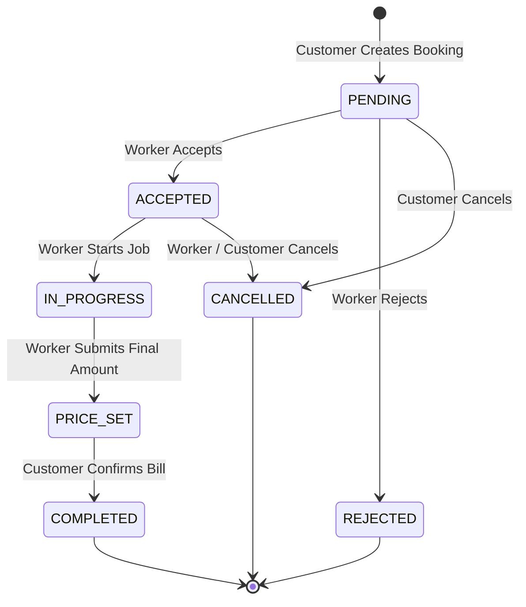

# FixMate — Project Specification & Implementation Context

> **Purpose of this document:** Complete context for any AI model or developer joining this project. Read fully before writing or modifying code. This is the single source of truth for architecture, data models, contracts, conventions, implementation state, and run commands.

---

## 1. Project Overview

**FixMate** is a production-ready MERN-stack hyperlocal marketplace web application that connects local residents with nearby blue-collar service workers (plumbers, electricians, carpenters, AC technicians, painters, appliance repair, etc.).

### Key Conceptual Model
- **Manual Browsing & Uber-Style Map:** The UX is inspired by map-first apps (Leaflet + OpenStreetMap with custom colored markers and popups), but the matching model is deliberate: **the customer browses and picks the worker manually**. There is no auto-dispatch engine. It mirrors Urban Company / JustDial with an Uber-like interactive map.
- **Login-First Entry Architecture:** For optimal security and personalized state management, unauthenticated visitors accessing the root `/` are immediately redirected to a unified `/login` page. Once authenticated, users are routed automatically to their role-specific dashboard:
  - `customer` $\to$ Customer Map & Search Dashboard (`/`)
  - `worker` $\to$ Worker Management Dashboard (`/worker`)
  - `admin` $\to$ Admin Operations Panel (`/admin`)
- **Unified Multi-Identifier Authentication:** A single login portal for all three roles (`customer`, `worker`, `admin`). Users can log in using either their **10-Digit Phone Number**, **Name** (case-insensitive), or **Email** alongside their password. There is strictly **no separate username field**; the user's registered name serves as their username.
- **Pure Server-Side Pricing Engine:** Transparent upfront estimate range ($\pm 15\%$) computed strictly on the backend based on visit charge, category base rate, distance beyond free allowance, urgency level, and night multipliers.
- **Privacy Phone Gating & Direct WhatsApp Settlement:** Phone numbers are strictly hidden from both parties until a booking status reaches `ACCEPTED`. Once accepted, plain-text phone numbers and prefilled WhatsApp deep links are revealed for offline scheduling, scope negotiation, and direct cash/UPI settlement.
- **Two-Way Job Lifecycle & Atomic Reviews:** Complete state machine audit log tracking transitions from `PENDING` $\to$ `ACCEPTED` $\to$ `IN_PROGRESS` $\to$ `PRICE_SET` $\to$ `COMPLETED`, followed by 1-5 star reviews with atomic rating aggregation on worker profiles.

---

## 2. Technology Stack

| Layer | Technology | Details & Rationale |
|---|---|---|
| **Frontend** | React 18 (Vite) | High performance, instant HMR, fast production builds |
| **Routing** | React Router v6 | Client-side routing with `ProtectedRoute` guards and role redirection |
| **Interactive Map** | Leaflet + `react-leaflet` | OpenStreetMap tiles; 100% free, zero billing cards, no API key leak risks |
| **Geocoding** | Nominatim (OSM) | Free location search; strictly debounced (600ms) to respect OSM usage policies |
| **State Management**| Zustand | Lightweight, hooks-based global store for auth and session persistence |
| **Styling & UI** | Tailwind CSS + Lucide Icons | Clean modern UI, responsive drawer sidebars, modal dialogs, status badges |
| **Backend** | Node.js + Express (ES Modules)| Modern JavaScript, clean layered MVC/Service architecture |
| **Database** | MongoDB Atlas + Mongoose | Native geospatial (`2dsphere`) indexing, atomic `$inc` counters, flexible schemas |
| **Authentication** | JWT + bcryptjs (cost 10) | Stateless token in `Authorization: Bearer <token>`, securely decoded client-side |
| **Validation** | Custom / Zod schemas | Strict route-boundary payload validation, 10-digit phone regex |

---

## 3. Roles & Permissions (RBAC)

| Role | Access & Capabilities |
|---|---|
| **Customer** | • Unified login / registration (10-digit phone, name, email)<br>• Search workers on Leaflet map by city, address, or map pin<br>• Filter workers by category, radius, and minimum rating<br>• View full worker profile, distance, rates, bio, and customer reviews<br>• Get live pricing estimates and submit booking requests<br>• View booking status timeline, worker plain-text phone, and WhatsApp link once accepted<br>• Confirm worker's submitted final price; submit 1-5 star review with tags |
| **Worker** | • Unified login / registration<br>• Manage worker profile: skills array with base rates, visit charge, address, GeoJSON location coordinates, service radius in meters<br>• Toggle live availability switch (`isAvailable`) to appear/disappear on customer map<br>• Real-time incoming bookings queue: Accept or Reject pending requests<br>• Access customer phone and WhatsApp after acceptance<br>• Mark job `IN_PROGRESS`<br>• Enter and submit final bill amount (`PRICE_SET`) after offline negotiation/completion |
| **Admin** | • Unified login with administrative privileges<br>• Platform KPI dashboard: Total users, workers, completed bookings, platform gross volume<br>• Worker Verification Queue: inspect worker profiles, review skills and toggle `isVerified`<br>• Dynamic Pricing Parameter Tuner: edit `perKmRate`, `freeDistanceM`, `urgencyFee`, `nightMultiplier`, `nightStartHour`, `estimateSpreadPct`, `deviationThresholdPct` without server restart<br>• Manage service categories (create and toggle active status) |

> [!IMPORTANT]
> All roles are verified server-side using the `protect` and `rbac('customer' | 'worker' | 'admin')` middleware. Roles submitted from client payloads during updates are never trusted.

---

## 4. Core User & Application Flows

```mermaid
flowchart TD
    Start([User visits /]) --> AuthCheck{Authenticated?}
    AuthCheck -- No --> Login[/login: Phone, Name, or Email + Password]
    Login --> VerifyCreds{Valid Credentials?}
    VerifyCreds -- No --> LoginErr[Display Error Message]
    VerifyCreds -- Yes --> RoleSwitch{Role?}

    AuthCheck -- Yes --> RoleSwitch
    RoleSwitch -- customer --> CustHome[/ - Customer Map & Search]
    RoleSwitch -- worker --> WorkDash[/worker - Worker Jobs & Availability]
    RoleSwitch -- admin --> AdminDash[/admin - Metrics & Verification]

    subgraph Customer Flow
        CustHome --> PinLoc[Pin Location or Nominatim Search]
        PinLoc --> SelectCat[Select Category]
        SelectCat --> ViewMarkers[View Workers on Leaflet Map]
        ViewMarkers --> OpenDrawer[Inspect Worker Profile & Reviews]
        OpenDrawer --> RequestEstimate[Request Live Price Estimate]
        RequestEstimate --> BookWorker[Submit Booking - Status: PENDING]
    end

    subgraph Worker & Settlement Flow
        BookWorker --> WorkerQueue[Worker Dashboard: New Booking]
        WorkerQueue --> AcceptReject{Accept or Reject?}
        AcceptReject -- Reject --> StatusRejected[Status: REJECTED]
        AcceptReject -- Accept --> StatusAccepted[Status: ACCEPTED]
        StatusAccepted --> PhoneRevealed[Phone & WhatsApp Revealed to Both]
        PhoneRevealed --> InProgress[Worker starts job - Status: IN_PROGRESS]
        InProgress --> FinalBill[Worker submits final price - Status: PRICE_SET]
        FinalBill --> CustConfirm[Customer confirms bill - Status: COMPLETED]
        CustConfirm --> CashSettled[Offline Cash / UPI Payment Settled]
        CashSettled --> LeaveReview[Customer submits 1-5 Star Review]
        LeaveReview --> AtomicUpdate[Worker ratingAgg updated atomically]
    end
```

### 4.1 Login & Entry Flow
1. **Root Redirect (`/`)**: Evaluates authentication state. Unauthenticated users are routed to `/login`.
2. **Unified Login (`/login`)**:
   - Single input field: **"Phone Number, Name, or Email"**.
   - Input identifier logic:
     - 10 digits $\to$ matched against `phone`.
     - Contains `@` $\to$ matched against lowercase `email`.
     - Text string $\to$ matched against `name` using case-insensitive regex.
   - Upon successful JWT generation, user data is saved to `localStorage` and Zustand store, then redirected to the corresponding role dashboard.
3. **Registration (`/register`)**:
   - Fields: Full Name (`name`), Phone Number (`phone`, strictly 10 digits), Email (`email`, optional), Password (`password`), and Role selection (`customer` or `worker`).
   - Phone input enforces `maxLength={10}` and sanitizes non-digit characters.

### 4.2 Customer Booking & Price Estimation Flow
1. Customer picks location (device GPS, map click, or Nominatim geocoding).
2. Customer selects category $\to$ backend executes `$geoNear` query returning available, verified workers within `serviceRadiusM`.
3. Workers are plotted as interactive Leaflet pins and summary cards with weighted rankings (composite of rating, proximity, and completed jobs).
4. Customer opens worker profile drawer and clicks "Book Service".
5. Customer enters problem details, urgency, and schedule time $\to$ client requests preview estimate from `/api/bookings/estimate`.
6. Server computes base, travel fee, urgency surcharge, and night multiplier, returning `{ min, max, breakdown }`.
7. Customer confirms $\to$ booking created with code `FM-XXXXXX` and status `PENDING`.

### 4.3 Worker Job Handling Flow
1. Worker receives pending booking in their dashboard.
2. Worker clicks "Accept" $\to$ status moves to `ACCEPTED`.
3. Customer and worker contact details are unmasked. Worker coordinates via phone or WhatsApp.
4. Worker arrives on site and updates status to `IN_PROGRESS`.
5. Worker completes job and enters agreed amount $\to$ status moves to `PRICE_SET`.
6. Customer reviews the final bill and clicks "Confirm" $\to$ status moves to `COMPLETED`.
7. Customer submits review $\to$ worker's `ratingAgg` updates atomically.

---

## 5. Data Models & Schemas

### 5.1 User Model (`users`)
```js
{
  _id: ObjectId,
  name: { type: String, required: true, trim: true },           // Used as display name & login username
  phone: { 
    type: String, 
    required: true, 
    unique: true, 
    match: [/^[0-9]{10}$/, 'Phone must be exactly 10 digits']  // Strict 10-digit validation
  },
  email: { type: String, unique: true, sparse: true, lowercase: true, trim: true },
  passwordHash: { type: String, required: true, select: false },
  role: { type: String, enum: ['customer', 'worker', 'admin'], default: 'customer' },
  avatarUrl: { type: String, default: '' },
  isActive: { type: Boolean, default: true },
  createdAt: Date,
  updatedAt: Date
}
```

### 5.2 Worker Profile Model (`workerProfiles`)
```js
{
  _id: ObjectId,
  userId: { type: ObjectId, ref: 'User', required: true, unique: true },
  bio: { type: String, default: '' },
  experienceYrs: { type: Number, default: 1 },
  skills: [{
    categoryId: { type: ObjectId, ref: 'Category', required: true },
    baseRate: { type: Number, required: true },
    rateUnit: { type: String, enum: ['PER_VISIT', 'PER_HOUR'], default: 'PER_VISIT' }
  }],
  visitCharge: { type: Number, default: 99 },                   // Flat inspection charge
  location: {
    type: { type: String, enum: ['Point'], default: 'Point' },
    coordinates: { type: [Number], required: true }             // [longitude, latitude]
  },
  address: {
    line: String,
    area: String,
    city: String,
    pincode: String
  },
  serviceRadiusM: { type: Number, default: 15000 },             // Stored in METERS
  isAvailable: { type: Boolean, default: true },
  isVerified: { type: Boolean, default: false },
  ratingAgg: {
    sum: { type: Number, default: 0 },
    count: { type: Number, default: 0 },
    avg: { type: Number, default: 0 }                          // Atomically updated via $inc
  },
  jobsCompleted: { type: Number, default: 0 },
  createdAt: Date,
  updatedAt: Date
}
```

### 5.3 Booking Model (`bookings`)
```js
{
  _id: ObjectId,
  code: { type: String, required: true, unique: true },         // Human-friendly FM-XXXXXX
  customerId: { type: ObjectId, ref: 'User', required: true },
  workerId: { type: ObjectId, ref: 'User', required: true },
  categoryId: { type: ObjectId, ref: 'Category', required: true },
  problemText: { type: String, required: true },
  photos: [{ type: String }],
  address: {
    line: { type: String, required: true },
    location: {
      type: { type: String, enum: ['Point'], default: 'Point' },
      coordinates: { type: [Number], required: true }           // [longitude, latitude]
    },
    city: { type: String, default: '' }
  },
  scheduledAt: { type: Date, required: true },
  urgency: { type: String, enum: ['NORMAL', 'IMMEDIATE'], default: 'NORMAL' },
  estimate: {
    breakdown: {
      visitCharge: Number,
      serviceBase: Number,
      travelCharge: Number,
      urgencyFee: Number,
      nightMultiplier: Number,
      subtotal: Number
    },
    min: Number,
    max: Number
  },
  final: {
    amount: Number,
    setBy: { type: ObjectId, ref: 'User' },
    confirmedAt: Date
  },
  status: {
    type: String,
    enum: ['PENDING', 'ACCEPTED', 'REJECTED', 'IN_PROGRESS', 'PRICE_SET', 'COMPLETED', 'CANCELLED'],
    default: 'PENDING'
  },
  timeline: [{
    status: String,
    at: { type: Date, default: Date.now },
    by: { type: ObjectId, ref: 'User' },
    note: String
  }],
  createdAt: Date,
  updatedAt: Date
}
```

### 5.4 Review Model (`reviews`)
```js
{
  _id: ObjectId,
  bookingId: { type: ObjectId, ref: 'Booking', required: true, unique: true }, // One review per booking
  workerId: { type: ObjectId, ref: 'User', required: true },
  customerId: { type: ObjectId, ref: 'User', required: true },
  rating: { type: Number, required: true, min: 1, max: 5 },
  tags: [{ type: String }],                                     // e.g. ['Punctual', 'Polite', 'Clean Work']
  text: { type: String, default: '' },
  createdAt: Date
}
```

### 5.5 Dynamic Pricing Config Model (`pricingConfig`)
```js
{
  perKmRate: { type: Number, default: 12 },                     // ₹12 per km after free distance
  freeDistanceM: { type: Number, default: 3000 },               // 3 km free radius
  urgencyFee: { type: Number, default: 149 },                   // Surcharge for IMMEDIATE bookings
  nightMultiplier: { type: Number, default: 1.25 },             // 25% surcharge for night calls
  nightStartHour: { type: Number, default: 21 },                // Starts at 9:00 PM (21:00)
  estimateSpreadPct: { type: Number, default: 0.15 },           // ±15% display range
  deviationThresholdPct: { type: Number, default: 0.30 }        // Alert customer if final > 30% above max
}
```

---

## 6. Geospatial Search & Ranking Pipeline

The worker discovery query uses a strict two-stage MongoDB aggregation pipeline:

```javascript
[
  // Stage 1: Native 2dsphere proximity search with cheap index filters
  {
    $geoNear: {
      near: { type: 'Point', coordinates: [parseFloat(lng), parseFloat(lat)] },
      distanceField: 'distanceM',
      maxDistance: 25000,                                       // Hard cap: 25 km
      spherical: true,
      query: {
        'skills.categoryId': new mongoose.Types.ObjectId(categoryId),
        isAvailable: true,
        isVerified: true
      }
    }
  },
  // Stage 2: In-memory filter for worker-customizable coverage radius
  {
    $match: {
      $expr: { $lte: ['$distanceM', '$serviceRadiusM'] }
    }
  },
  // Stage 3: Hydrate user profile data
  {
    $lookup: {
      from: 'users',
      localField: 'userId',
      foreignField: '_id',
      as: 'user'
    }
  },
  { $unwind: '$user' },
  // Stage 4: Composite ranking score: 50% rating, 30% proximity, 20% experience
  {
    $addFields: {
      ratingScore: { $multiply: [{ $ifNull: ['$ratingAgg.avg', 3.5] }, 20] }, // 0 to 100
      proximityScore: { 
        $multiply: [
          { $max: [0, { $subtract: [1, { $divide: ['$distanceM', 25000] }] }] }, 
          100 
        ] 
      },
      experienceScore: { $min: [100, { $multiply: ['$jobsCompleted', 5] }] }
    }
  },
  {
    $addFields: {
      score: {
        $add: [
          { $multiply: ['$ratingScore', 0.50] },
          { $multiply: ['$proximityScore', 0.30] },
          { $multiply: ['$experienceScore', 0.20] }
        ]
      }
    }
  },
  { $sort: { score: -1 } },
  { $limit: 50 }
]
```

---

## 7. Pricing Engine Architecture

Located at `server/src/modules/pricing/engine.js`. **Pure mathematical calculation with zero database access.**

### Calculation Formula
$$\text{Base} = \text{visitCharge} + \text{serviceBase}$$
$$\text{BillableKm} = \max\left(0, \frac{\text{distanceM} - \text{freeDistanceM}}{1000}\right)$$
$$\text{TravelCharge} = \text{round}(\text{BillableKm} \times \text{perKmRate})$$
$$\text{UrgencyCharge} = \text{urgency} = \text{"IMMEDIATE"} \;?\; \text{urgencyFee} : 0$$
$$\text{Subtotal} = \text{Base} + \text{TravelCharge} + \text{UrgencyCharge}$$
$$\text{Multiplier} = (\text{hour} \ge \text{nightStartHour} \lor \text{hour} < 6) \;?\; \text{nightMultiplier} : 1.0$$
$$\text{Total} = \text{round}(\text{Subtotal} \times \text{Multiplier})$$
$$\text{Min} = \text{round}(\text{Total} \times (1 - \text{estimateSpreadPct}))$$
$$\text{Max} = \text{round}(\text{Total} \times (1 + \text{estimateSpreadPct}))$$

---

## 8. Booking State Machine & Privacy Rules

The state transition logic is centralized inside `server/src/modules/bookings/stateMachine.js`:



### Privacy & Masking Policy
- Prior to `ACCEPTED`, the worker's phone is **completely stripped** from all customer API responses.
- Prior to `ACCEPTED`, the customer's phone is **completely stripped** from all worker API responses.
- Once `ACCEPTED`, phone numbers are revealed as **plain text** alongside a direct WhatsApp deep link formatted with an automated prefilled message:
  `https://wa.me/91<10_DIGIT_PHONE>?text=Hi%20FixMate%20booking%20<CODE>`

---

## 9. API Reference

All responses follow the unified envelope:
- Success: `{ "success": true, "data": { ... } }`
- Error: `{ "success": false, "error": { "code": "ERROR_CODE", "message": "Human readable message" } }`

### Authentication (`/api/auth`)
| Method | Endpoint | Access | Payload / Query | Description |
|---|---|---|---|---|
| `POST` | `/api/auth/register` | Public | `{ name, phone, email?, password, role }` | Register user (phone must be 10 digits) |
| `POST` | `/api/auth/login` | Public | `{ identifier, password }` | Login via 10-digit phone, name, or email |
| `GET` | `/api/auth/me` | Authenticated | *None* | Get current user profile and role |

### Categories (`/api/categories`)
| Method | Endpoint | Access | Payload / Query | Description |
|---|---|---|---|---|
| `GET` | `/api/categories` | Public | *None* | Get all active service categories |
| `POST` | `/api/categories` | Admin | `{ name, icon, slug? }` | Create new service category |

### Workers (`/api/workers`)
| Method | Endpoint | Access | Payload / Query | Description |
|---|---|---|---|---|
| `GET` | `/api/workers/search` | Public | `?lat&lng&categoryId&radius&minRating&sort` | Geospatial 2dsphere coverage search |
| `GET` | `/api/workers/:id` | Public | *None* | Full profile, skills, and reviews |
| `POST` | `/api/workers/profile` | Worker | `{ bio, experienceYrs, skills, visitCharge, location, address, serviceRadiusM }` | Create or update profile |
| `PATCH` | `/api/workers/availability` | Worker | `{ isAvailable: Boolean }` | Toggle online/offline status |

### Bookings (`/api/bookings`)
| Method | Endpoint | Access | Payload / Query | Description |
|---|---|---|---|---|
| `POST` | `/api/bookings/estimate` | Authenticated | `{ workerId, categoryId, lat, lng, scheduledAt, urgency }` | Calculate server-side price estimate |
| `POST` | `/api/bookings` | Customer | `{ workerId, categoryId, problemText, photos, address, scheduledAt, urgency }` | Create booking |
| `GET` | `/api/bookings/my` | Authenticated | `?status` | Role-filtered booking history |
| `GET` | `/api/bookings/:id` | Authenticated | *None* | Fetch booking details & timeline |
| `PATCH` | `/api/bookings/:id/status` | Worker/Customer | `{ status }` | Execute state machine transition |
| `PATCH` | `/api/bookings/:id/final-price` | Worker | `{ amount: Number }` | Submit final bill (`PRICE_SET`) |
| `PATCH` | `/api/bookings/:id/confirm` | Customer | *None* | Confirm final bill (`COMPLETED`) |

### Reviews (`/api/reviews`)
| Method | Endpoint | Access | Payload / Query | Description |
|---|---|---|---|---|
| `POST` | `/api/reviews` | Customer | `{ bookingId, rating, tags, text }` | Submit review (atomic `$inc` on worker) |
| `GET` | `/api/reviews/worker/:id` | Public | *None* | List worker's public reviews |
| `GET` | `/api/reviews/booking/:bookingId` | Authenticated | *None* | Check existing review for booking |

### Admin (`/api/admin`)
| Method | Endpoint | Access | Payload / Query | Description |
|---|---|---|---|---|
| `GET` | `/api/admin/stats` | Admin | *None* | Platform KPIs and volume metrics |
| `GET` | `/api/admin/workers/pending` | Admin | *None* | List unverified worker applications |
| `PATCH` | `/api/admin/workers/:id/verify` | Admin | `{ isVerified: Boolean }` | Approve or revoke worker verification |
| `GET` | `/api/admin/pricing-config` | Admin | *None* | Retrieve active pricing parameters |
| `PATCH` | `/api/admin/pricing-config` | Admin | `{ perKmRate, freeDistanceM, ... }` | Update dynamic pricing configuration |

---

## 10. Folder Structure

```
Fixmate/
├── FIXMATE_PROJECT_SPEC.md              # Complete specification & AI instructions
├── README.md                            # Project overview, architecture, & quickstart
│
├── server/                              # Node.js + Express API backend
│   ├── .env                             # Environment configuration (PORT, MONGO_URI, JWT_SECRET)
│   ├── package.json
│   └── src/
│       ├── config/
│       │   ├── constants.js             # Booking statuses, roles, default constants
│       │   ├── db.js                    # MongoDB Mongoose connection
│       │   └── env.js                   # Enforced environment variable validator
│       ├── middleware/
│       │   ├── auth.js                  # JWT extraction & user hydration
│       │   ├── errorHandler.js          # Centralized error handler returning standard JSON envelope
│       │   ├── rbac.js                  # Role-based access control guard
│       │   └── validate.js              # Request validation handler
│       ├── modules/
│       │   ├── admin/                   # Admin KPIs, verification, Worker & Customer CRUD, Category CRUD, pricing config
│       │   ├── auth/                    # Multi-identifier login, user model with address/avatar, profile update, auth validator
│       │   ├── bookings/                # Booking model, state machine, lifecycle controller, address validation
│       │   ├── categories/              # Category model, controller, & routes
│       │   ├── pricing/                 # Pure calculation engine (with worker perKmRate) & pricingConfig model
│       │   ├── reviews/                 # Review model, atomic worker rating updater
│       │   └── workers/                 # WorkerProfile model (with perKmRate), 2dsphere search controller, profile pre-fill
│       ├── seed/
│       │   └── full.seed.js             # Comprehensive multi-role seed script
│       ├── utils/
│       │   ├── AppError.js              # Operational HTTP error class
│       │   ├── asyncHandler.js          # Async wrapper eliminating try/catch boilerplate
│       │   └── geo.js                   # Haversine distance calculator
│       ├── app.js                       # Express app configuration & middleware
│       └── server.js                    # Entry point listener
│
└── client/                              # React 18 + Vite frontend
    ├── package.json
    ├── vite.config.js
    ├── index.html
    └── src/
        ├── components/
        │   ├── common/                  # Modal, Spinner, StarRating, AvatarPickerModal UI primitives
        │   ├── layout/
        │   │   ├── NavBar.jsx           # Global navigation with role badge, customer profile link, & logout
        │   │   └── ProtectedRoute.jsx   # Route guard enforcing authentication & role
        │   └── map/
        │       ├── LocationPickerModal.jsx # Interactive Leaflet map picker & reverse geocoding
        │       ├── MapView.jsx          # Leaflet map container & tile layer
        │       ├── RadiusCircle.jsx     # Coverage circle overlay
        │       └── WorkerMarker.jsx     # Custom styled Leaflet pins & popup
        ├── features/
        │   ├── booking/
        │   │   ├── BookingModal.jsx     # Booking form with address auto-fill, GPS/map picker & estimate preview
        │   │   └── CustomerLocationModal.jsx # Worker modal to view customer profile, map pin & Google Maps directions
        │   ├── reviews/
        │   │   └── ReviewModal.jsx      # Star rating and tag submission modal
        │   └── worker/
        │       └── WorkerDetailPanel.jsx# Slide-over drawer with worker bio, skills, reviews, distance in km
        ├── hooks/
        │   └── useDebounce.js           # 600ms input debounce for Nominatim search
        ├── pages/
        │   ├── AdminPanel.jsx           # Modern sidebar: Overview, Find Workers, Worker CRUD, Customer CRUD, Category CRUD, Pricing
        │   ├── CustomerHome.jsx         # Map-first search, preserved customer search pin, worker discovery page
        │   ├── CustomerProfile.jsx      # Customer personal info, avatar selection, permanent address with GPS/map picker
        │   ├── Login.jsx                # Multi-identifier login page (phone/name/email)
        │   ├── MyBookings.jsx           # Customer booking history & WhatsApp connect
        │   ├── Register.jsx             # 10-digit phone registration form
        │   ├── WorkerDashboard.jsx      # Worker live orders, customer & map viewer, bill submission, availability
        │   └── WorkerProfileSetup.jsx   # Worker profile edit with pre-fill, avatar selection, GPS/map picker, perKmRate
        ├── services/
        │   └── api.js                   # Axios client with JWT request interceptor
        ├── store/
        │   └── authStore.js             # Zustand authentication state store with updateUser support
        ├── App.jsx                      # App routes & root redirect logic
        └── main.jsx                     # React root mount
```

---

## 11. Implementation Status (Phases 1–9)

All core phases and hyper-local production enhancements have been built and verified:

| Phase | Milestone | Implemented Artifacts | Status |
|---|---|---|:---:|
| **1** | **Setup, Database & Auth** | `server/src/modules/auth/` (`user.model.js`, `auth.service.js`, `auth.controller.js`, `auth.validator.js`), `client/src/pages/Login.jsx`, `Register.jsx`, `authStore.js`, `ProtectedRoute.jsx`. Multi-identifier login (10-digit phone, name, email). | **COMPLETE** |
| **2** | **Categories & Worker Profiles** | `server/src/modules/categories/`, `server/src/modules/workers/workerProfile.model.js`, `workers.service.js`, `workers.controller.js`. Availability toggle and profile setup. | **COMPLETE** |
| **3** | **Interactive Map & Geo Search** | `MapView.jsx`, `WorkerMarker.jsx`, `RadiusCircle.jsx`, `CustomerHome.jsx`, `useDebounce.js`. Nominatim geocoding, MongoDB 2dsphere aggregation with weighted scoring. | **COMPLETE** |
| **4** | **Worker Profile Drawer** | `WorkerDetailPanel.jsx`. Slide-over drawer displaying rates, experience, bio, customer reviews, distance in km, and direct "Book" button. | **COMPLETE** |
| **5** | **Pricing Engine & Booking Preview** | `server/src/modules/pricing/` (`engine.js`, `pricingConfig.model.js`), `BookingModal.jsx`. Live upfront estimate range ($\pm 15\%$) fetched from server before booking. | **COMPLETE** |
| **6** | **Booking Lifecycle & Privacy Gating** | `server/src/modules/bookings/` (`booking.model.js`, `stateMachine.js`, `bookings.service.js`), `MyBookings.jsx`, `WorkerDashboard.jsx`. Plain-text phone reveal and prefilled WhatsApp link only after acceptance. | **COMPLETE** |
| **7** | **Reviews & Atomic Aggregation** | `server/src/modules/reviews/` (`review.model.js`, `reviews.service.js`, `reviews.controller.js`), `ReviewModal.jsx`, `StarRating.jsx`. Atomic `$inc` updates to worker `ratingAgg`. | **COMPLETE** |
| **8** | **Admin Operations & Full CRUD** | `server/src/modules/admin/`, `AdminPanel.jsx`, full sidebar layout, Worker CRUD, Customer CRUD, Category CRUD, pricing tuner. | **COMPLETE** |
| **9** | **Profile & Map Enhancements** | Customer Profile (`/customer/profile`), Worker Profile pre-fill & DP edit, worker `perKmRate`, GPS / Map pin auto-fill (reverse geocoded), address validation, Worker View Customer & Map modal (`CustomerLocationModal`). | **COMPLETE** |


---

## 12. Demo Credentials & How to Run

### 12.1 Environment Setup
Verify `server/.env` contains valid values:
```env
PORT=5000
NODE_ENV=development
MONGO_URI=mongodb://localhost:27017/fixmate    # or valid MongoDB Atlas connection string
JWT_SECRET=fixmate_super_secret_jwt_key_2026_production
CLIENT_URL=http://localhost:5173
```

### 12.2 Seeding Sample Data
Run the comprehensive seed script from the server directory:
```bash
cd D:\Fixmate\server
npm run seed
```
This populates:
- Default `PricingConfig` parameters
- 6 standard service categories (Plumber, Electrician, Carpenter, AC Technician, Painter, Appliance Repair)
- 1 Admin account
- 2 Customer accounts (with completed and active bookings)
- 3 Verified Worker accounts (Plumber, Electrician, Carpenter) located around Mumbai with active profiles and reviews

### 12.3 Starting the Development Servers
Open two terminal windows:

**Terminal 1 — Backend API:**
```bash
cd D:\Fixmate\server
npm run dev
# Server listens on http://localhost:5000
```

**Terminal 2 — Frontend Application:**
```bash
cd D:\Fixmate\client
npm run dev
# Client runs on http://localhost:5173
```

### 12.4 Demo Credentials

| Role | Multi-Identifier Login (Any of these) | Password | Target Dashboard |
|---|---|---|---|
| **Admin** | **Phone:** `9999999999`<br>**Name:** `Admin Fixmate`<br>**Email:** `admin@fixmate.in` | `Admin@123` | `/admin` |
| **Worker (Plumber)** | **Phone:** `9820098200`<br>**Name:** `Ramesh Sharma`<br>**Email:** `ramesh@fixmate.in` | `Worker@123` | `/worker` |
| **Worker (Electrician)** | **Phone:** `9820098201`<br>**Name:** `Suresh Verma`<br>**Email:** `suresh@fixmate.in` | `Worker@123` | `/worker` |
| **Customer (Active)** | **Phone:** `9819998199`<br>**Name:** `Priya Mehta`<br>**Email:** `priya@fixmate.in` | `Customer@123` | `/` |
| **Customer (New)** | **Phone:** `9819998198`<br>**Name:** `Rahul Joshi`<br>**Email:** `rahul@fixmate.in` | `Customer@123` | `/` |
