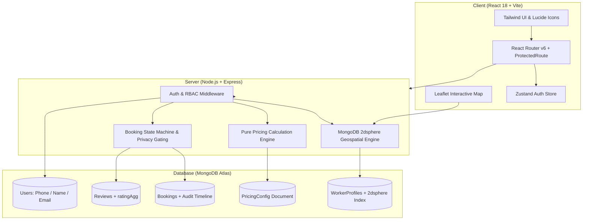
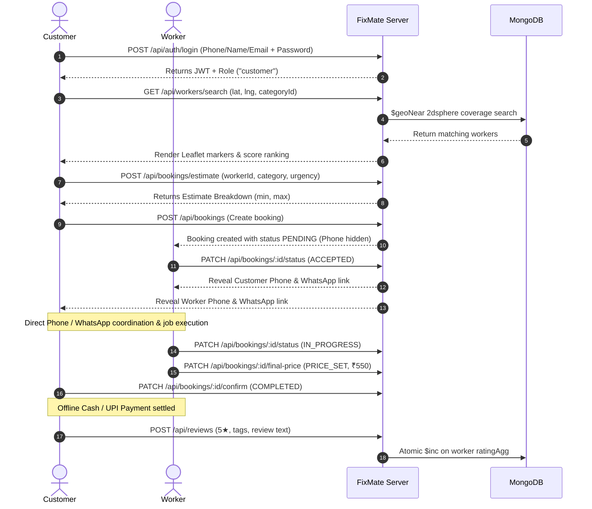

# FixMate 🛠️

> **Hyperlocal Blue-Collar Service Marketplace (MERN Stack)**  
> Connecting local residents with trusted nearby service professionals (plumbers, electricians, carpenters, AC technicians) through an interactive map-first experience, transparent upfront pricing, privacy-first phone gating, and WhatsApp settlement.

---

## 📌 Table of Contents
- [Overview](#-overview)
- [Key Features](#-key-features)
- [System Architecture](#-system-architecture)
- [Tech Stack](#-tech-stack)
- [Project Structure](#-project-structure)
- [Getting Started](#-getting-started)
- [Demo Credentials](#-demo-credentials)
- [Core Workflows](#-core-workflows)
- [API Reference](#-api-reference)
- [State Machine & Privacy Rules](#-state-machine--privacy-rules)

---

## 🔍 Overview

FixMate brings the speed and convenience of Uber/Rapido-style map interfaces to home repair and maintenance services. Instead of automated dispatch, FixMate empowers customers to **manually inspect, evaluate, and choose** nearby service workers based on verified profiles, ratings, hourly/visit rates, and customer reviews.

### Why FixMate?
1. **Unified Multi-Identifier Login:** Single secure entry portal for Customers, Workers, and Admins supporting login via **10-Digit Phone Number**, **Name** (case-insensitive), or **Email**.
2. **Transparent Upfront Estimates:** Pure server-side pricing engine computes an estimated range ($\pm 15\%$) based on visit fee, category base rate, distance beyond free allowance, urgency level, and night multipliers.
3. **Privacy by Design:** Phone numbers are strictly unmasked only after a worker explicitly accepts a job.
4. **Frictionless Offline Settlement:** Direct WhatsApp deep link generation with prefilled booking codes allows customers and workers to coordinate and settle payments via cash or UPI offline.

---

## 🌟 Key Features

### For Customers 🏠
- **Customer Profile & Saved Address:** Manage personal profile, avatar, and permanent home address with GPS auto-detect and interactive Leaflet map pin picker.
- **Smart Booking Address Auto-Fill:** Automatically pre-fills customer permanent address at booking time, with quick "Use GPS" and "Pick on Map" options and strict address validation.
- **Map-First Worker Discovery:** OpenStreetMap (Leaflet) displaying available workers with custom interactive markers.
- **Accurate Distance Display:** Accurately calculates and renders worker's distance in km without resetting when previewing workers.
- **Debounced Search:** Smooth location search powered by Nominatim OSM geocoding (600ms debounce).
- **Worker Profile Drawer:** Slide-over panel detailing bio, experience, skills, rates (hourly, visit, per-km), distance in km, and real user reviews.
- **Live Estimate Preview:** Transparent cost breakdown before placing a booking.
- **Real-Time Booking Tracker:** Step-by-step timeline of booking status, worker contact card, and WhatsApp action.
- **Two-Way Price Confirmation & Reviews:** Review final bill and submit 1–5 star reviews with tags.

### For Service Workers 🔧
- **Interactive Worker Dashboard:** View incoming booking requests in real time.
- **Customer Profile & Map Pin Inspection:** Workers can click "View Customer & Map" on any booking to view customer avatar, details, problem description, distance, and interactive map marker with one-click Google Maps turn-by-turn directions.
- **Profile Setup & DP Management:** Pre-fills existing profile details automatically, allows avatar selection, and replaces raw lat/lng with instant "Use GPS" or Leaflet map pin pickers that auto-populate street, area, city, and pincode.
- **Custom Per-KM Travel Rate:** Workers can specify their own travel rate per kilometer, which feeds directly into the server's pure pricing calculation engine.
- **Availability Switch:** Toggle online/offline status with an instant switch to control map visibility.
- **Accept / Reject Orders:** Inspect problem details, customer address, and distance before taking a job.
- **Direct Communication:** Unmask customer phone number and launch direct WhatsApp chat upon acceptance.
- **Final Bill Submission:** Enter final agreed labor/material charges upon completing work.

### For Administrators 🛡️
- **Modern Admin Sidebar:** Clean sidebar navigation with quick access to Admin Overview, Find Workers, Worker Management, Customer Management, Category Management, and Pricing Settings (with deprecated Worker Hub removed).
- **Worker Management CRUD:** Full control to inspect, edit rates/verification status, or delete worker records.
- **Customer Management CRUD:** Search, view, edit contact info/status, or remove customer accounts.
- **Service Category CRUD:** Dynamically create new service categories, edit icons/names, or delete unused categories.
- **Platform Analytics & KPIs:** Track platform users, verified workers, completed jobs, and gross service volume.
- **Dynamic Pricing Tuner:** Live dashboard to adjust base rates, per-km fees, urgency surcharges, and night multipliers without restarting the server.


---

## 🏗️ System Architecture



---

## 💻 Tech Stack

| Layer | Technology |
|---|---|
| **Frontend** | React 18, Vite, React Router v6, Tailwind CSS, Lucide React, Zustand, Axios |
| **Mapping & GIS** | Leaflet, `react-leaflet`, OpenStreetMap tiles, Nominatim OSM Geocoding |
| **Backend** | Node.js (ES Modules), Express.js |
| **Database** | MongoDB Atlas, Mongoose (`2dsphere` spatial indexing) |
| **Security** | JWT (JSON Web Tokens), bcryptjs (password hashing, cost 10) |
| **Code Quality** | Oxlint, ES Lint |

---

## 📂 Project Structure

```
Fixmate/
├── FIXMATE_PROJECT_SPEC.md              # Technical specification & guidelines
├── README.md                            # Project overview & quickstart
│
├── server/                              # Node.js + Express API backend
│   ├── .env                             # Environment configuration
│   ├── package.json
│   └── src/
│       ├── config/                      # Database connection, env validation, constants
│       ├── middleware/                  # JWT auth, RBAC guards, error handler, validator
│       ├── modules/
│       │   ├── admin/                   # Admin KPIs, worker verification, dynamic pricing
│       │   ├── auth/                    # Multi-identifier login, user model, auth validator
│       │   ├── bookings/                # Booking state machine, lifecycle controller, model
│       │   ├── categories/              # Category CRUD
│       │   ├── pricing/                 # Pure pricing calculation engine & pricingConfig
│       │   ├── reviews/                 # Review model, atomic worker rating updater ($inc)
│       │   └── workers/                 # Worker profile model & 2dsphere spatial search
│       ├── seed/
│       │   └── full.seed.js             # Comprehensive multi-role seed data generator
│       ├── utils/                       # AppError, asyncHandler, Haversine geo formula
│       ├── app.js                       # Express app configuration
│       └── server.js                    # Entry point listener
│
└── client/                              # React 18 + Vite frontend
    ├── package.json
    ├── vite.config.js
    └── src/
        ├── components/
        │   ├── common/                  # Modal, Spinner, StarRating primitives
        │   ├── layout/                  # NavBar with role badge, ProtectedRoute guards
        │   └── map/                     # MapView, WorkerMarker, RadiusCircle
        ├── features/
        │   ├── booking/                 # BookingModal with live server estimate preview
        │   ├── reviews/                 # ReviewModal with star rating and tag selector
        │   └── worker/                  # WorkerDetailPanel slide-over drawer
        ├── hooks/                       # useDebounce for geocoding input
        ├── pages/
        │   ├── AdminPanel.jsx           # Admin KPIs, worker approvals, pricing tuner
        │   ├── CustomerHome.jsx         # Map search & worker discovery page
        │   ├── Login.jsx                # Multi-identifier login (phone, name, email)
        │   ├── MyBookings.jsx           # Customer bookings, status tracker, WhatsApp
        │   ├── Register.jsx             # 10-digit phone registration form
        │   └── WorkerDashboard.jsx      # Worker orders, bill submission, availability
        ├── services/                    # Axios client with JWT interceptor
        ├── store/                       # Zustand auth store
        └── App.jsx                      # Route configurations & login-first redirection
```

---

## 🚀 Getting Started

### Prerequisites
- [Node.js](https://nodejs.org/) (v18 or higher)
- [MongoDB](https://www.mongodb.com/) (Local community edition or MongoDB Atlas URI)

### 1. Configure Backend Environment
Navigate to `server/` and verify `.env`:
```env
PORT=5000
NODE_ENV=development
MONGO_URI=mongodb://localhost:27017/fixmate
JWT_SECRET=fixmate_super_secret_jwt_key_2026_production
CLIENT_URL=http://localhost:5173
```

### 2. Install Dependencies & Seed Database
```bash
# Backend setup
cd server
npm install
npm run seed

# Frontend setup
cd ../client
npm install
```

### 3. Start Development Servers
Open two terminal tabs:

**Terminal 1 (Backend):**
```bash
cd server
npm run dev
# Running on http://localhost:5000
```

**Terminal 2 (Frontend):**
```bash
cd client
npm run dev
# Running on http://localhost:5173
```

Visit **http://localhost:5173** in your browser. Unauthenticated visitors are automatically routed to `/login`.

---

## 🔑 Demo Credentials

| Role | Multi-Identifier Login (Use Any) | Password | Portal URL |
|---|---|---|---|
| **Admin** | **Phone:** `9999999999`<br>**Name:** `Admin Fixmate`<br>**Email:** `admin@fixmate.in` | `Admin@123` | `/admin` |
| **Worker (Plumber)** | **Phone:** `9820098200`<br>**Name:** `Ramesh Sharma`<br>**Email:** `ramesh@fixmate.in` | `Worker@123` | `/worker` |
| **Worker (Electrician)** | **Phone:** `9820098201`<br>**Name:** `Suresh Verma`<br>**Email:** `suresh@fixmate.in` | `Worker@123` | `/worker` |
| **Customer (Active)** | **Phone:** `9819998199`<br>**Name:** `Priya Mehta`<br>**Email:** `priya@fixmate.in` | `Customer@123` | `/` |
| **Customer (New)** | **Phone:** `9819998198`<br>**Name:** `Rahul Joshi`<br>**Email:** `rahul@fixmate.in` | `Customer@123` | `/` |

---

## 🔄 Core Workflows



---

## 📡 API Reference

### Auth (`/api/auth`)
- `POST /api/auth/register` — Register new user (enforces 10-digit phone number)
- `POST /api/auth/login` — Unified login via 10-digit phone, name, or email
- `GET /api/auth/me` — Hydrate current user profile and role
- `PATCH /api/auth/profile` — Update customer/user profile (name, email, avatarUrl, permanent address)

### Workers (`/api/workers`)
- `GET /api/workers/search` — Geospatial search (`lat`, `lng`, `categoryId`, `radius`, `minRating`)
- `GET /api/workers/:id` — Full public profile with skills, rates, and reviews
- `GET /api/workers/profile/me` — Fetch current worker's existing profile for editing
- `POST /api/workers/profile` — Worker updates skills, base rate, visit fee, per-km rate, location, address, and radius
- `PATCH /api/workers/availability` — Toggle online/offline state

### Bookings (`/api/bookings`)
- `POST /api/bookings/estimate` — Calculate transparent upfront price estimate (considers worker perKmRate)
- `POST /api/bookings` — Create a new service booking (requires address.line & city)
- `GET /api/bookings/my` — Fetch role-aware booking history
- `GET /api/bookings/:id` — Booking details with audit timeline
- `PATCH /api/bookings/:id/status` — State machine transition (`ACCEPTED`, `REJECTED`, `IN_PROGRESS`)
- `PATCH /api/bookings/:id/final-price` — Worker submits final charge (`PRICE_SET`)
- `PATCH /api/bookings/:id/confirm` — Customer confirms final charge (`COMPLETED`)

### Reviews (`/api/reviews`)
- `POST /api/reviews` — Submit review for completed booking (updates worker rating atomically)
- `GET /api/reviews/worker/:id` — Public reviews for a worker
- `GET /api/reviews/booking/:bookingId` — Review status for a specific booking

### Admin (`/api/admin`)
- `GET /api/admin/stats` — Platform KPIs and gross volume metrics
- `GET /api/admin/workers` — List and search workers
- `PATCH /api/admin/workers/:id` — Update worker hourly rate, visit fee, perKmRate, bio, verification
- `DELETE /api/admin/workers/:id` — Delete worker profile & user
- `GET /api/admin/customers` — List and search customers
- `PATCH /api/admin/customers/:id` — Update customer name, email, phone, role
- `DELETE /api/admin/customers/:id` — Delete customer account
- `POST /api/admin/categories` — Create a new service category
- `PATCH /api/admin/categories/:id` — Update existing category (name, slug, icon, baseRate)
- `DELETE /api/admin/categories/:id` — Delete service category
- `GET /api/admin/pricing-config` — Current dynamic pricing parameters
- `PATCH /api/admin/pricing-config` — Update dynamic pricing parameters


---

## 🔒 State Machine & Privacy Rules

### Lifecycle States
1. `PENDING` $\to$ Booking submitted by customer. Worker's phone is hidden.
2. `ACCEPTED` $\to$ Worker accepts. Phone numbers are unmasked in plain text and direct WhatsApp link is enabled.
3. `REJECTED` $\to$ Worker declines request.
4. `IN_PROGRESS` $\to$ Worker arrives and initiates service.
5. `PRICE_SET` $\to$ Worker submits final bill.
6. `COMPLETED` $\to$ Customer confirms payment. Unlocks review form.
7. `CANCELLED` $\to$ Booking cancelled by either party prior to completion.

---

## 📄 License
FixMate is built as an academic MERN marketplace project. All rights reserved.
